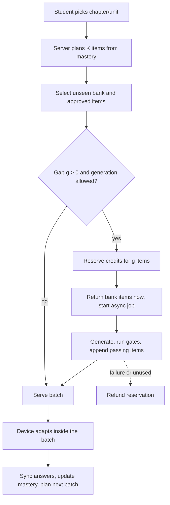
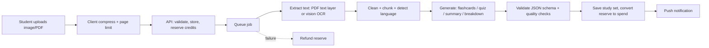

# Mothakira (مذكرة) – Product & Technical Plan

Working name. Android study app for Sudanese students. Students buy credits by Bankak transfer (manual receipt review), spend credits on curriculum content and AI study tools.

This file is run as a **court**. Agent 1 (Architect) wrote Part A. Agent 2 (Critic) runs Part B against it and records objections in Part C. The owner is the Judge and rules on every disputed item.

---

## Part A – The Plan (Architect)

### A0. Assumptions (no answers were available, so these are defaults)

Each assumption is open to challenge. Items marked **[Q]** need an owner answer (see A12).

| #   | Assumption                                                                                                                                                                                                                                                                                                                                                                                 |
| --- | ------------------------------------------------------------------------------------------------------------------------------------------------------------------------------------------------------------------------------------------------------------------------------------------------------------------------------------------------------------------------------------------ |
| 1   | Students are on mid/low-end Android (Android 8+, 2–3 GB RAM), unstable and expensive data, frequent power cuts.                                                                                                                                                                                                                                                                            |
| 2   | Arabic is the primary UI language (RTL). English content is supported per subject.                                                                                                                                                                                                                                                                                                         |
| 3   | Launch class = **Secondary School Certificate** (final secondary year, Sudan Examinations Council). Content is organised by **exam year/session + class + subject** (e.g. April 2026). Classes, streams, subjects and the subject-to-stream mapping are admin-configured data, not hard-coded. Other classes come later.                                                                   |
| 4   | Single owner/admin team at launch, under ~10k students in the first 6 months. **[Q]**                                                                                                                                                                                                                                                                                                      |
| 5   | Payments are SDG transfers via Bankak (Bank of Khartoum). No payment API, so verification is manual. Distribution is APK-first; Play Billing is not assumed to be usable for Sudanese users (UNVERIFIED, ruling J3).                                                                                                                                                                       |
| 6   | Content in CSV is typed text. Images in questions are **optional**: a question or passage may reference one image file, but no question requires one. Math is written as LaTeX between `$...$` in question text and rendered with KaTeX (dashboard) and a Flutter math package (app), so maths and science papers are supported. Scanned papers are never shown to students as-is. **[Q]** |
| 7   | Past papers are public (owner's statement, ruling J1). The plan still records each paper's source and the owner's declaration and keeps a takedown process, since "publicly available" is not automatically a licence to resell (not legal advice; UNVERIFIED for Sudan). Answer keys, criteria and explanations are owner/teacher-authored.                                               |
| 8   | Sign-in is phone number + password with a recovery code issued at signup. One SMS OTP at signup is added only if SMS delivery in Sudan is verified in Phase 0. **[Q]**                                                                                                                                                                                                                     |
| 9   | Official answer keys may not exist for every paper. Keys and marking criteria are supplied by the owner/teachers and carry a verification status (A1b). **[Q]**                                                                                                                                                                                                                            |
| 10  | Demand is seasonal and peaks before each exam session. **[Q]**                                                                                                                                                                                                                                                                                                                             |
| 11  | The workspace is greenfield (only Flutter build output and this plan). Owner's stack: Flutter (feature-first, `provider` for state), Node.js + Express in plain JavaScript, hosted MongoDB (Atlas), React dashboard. No existing code is reused.                                                                                                                                           |
| 12  | UI languages are Arabic (default, RTL) and English (LTR), switchable at any time. The language of an exam or lesson is independent of the UI language (A3d).                                                                                                                                                                                                                               |
| 13  | Hosting starts on free tiers: a MongoDB Atlas free cluster and a Render free web service for the Express API. These are for development and a small pilot only; accepting real student money requires the go-live gate (A8c). **[Q]**                                                                                                                                                      |

### A1. Vision and scope

- **Launch wedge:** Secondary School Certificate **past exams** with answer keys and marking criteria (details in A1b). Everything else (lessons, student uploads) builds on the same engine.
- **Core loop:** pick subject → pick exam paper → practise or sit a timed mock → get marked against the key/criteria → weak topics become flashcards/quizzes → pay credits as needed.
- **Personal practice:** a free trial of admin-flagged questions, then adaptive practice that picks the next vetted question from the student's answers and, where the bank has gaps, adds AI-generated questions grounded in the chapter text (A1c).
- **Two content sources:**
  1. **Official content** – curated by the owner through the React dashboard (CSV import).
  2. **Student content** – photo or PDF uploaded by the student, turned into study material by AI.
- **Out of scope for MVP:** social features, live tutoring, video, iOS, web student app, online card payments, handwritten-answer marking.

### A1b. Launch focus – Secondary School Certificate exams

**What the two sample papers (English Literature and Arabic, April 2026 session, 3 hours each) tell us about the data we must model:**

| Observation                                                                                                                                                          | Design consequence                                                                                                                   |
| -------------------------------------------------------------------------------------------------------------------------------------------------------------------- | ------------------------------------------------------------------------------------------------------------------------------------ |
| One paper = one subject + one session + fixed duration + total marks (both samples total 100: English = 2 parts × 50; Arabic = 7 questions at 15/15/10/15/15/15/15). | `exams` table with `duration_minutes`, `total_marks`. Import validates that top-level marks sum to the total.                        |
| Deep numbering: Part → Question → section (A/B/C or أ/ب/ج) → sub-question → sub-items.                                                                               | Questions are a **tree** (self-referencing), addressed by a dotted `path` such as `1.A.3`.                                           |
| Mixed question types in one paper (see table below).                                                                                                                 | A `type` enum, each with its own key format and marking method.                                                                      |
| Shared material: reading passage (e.g. فن التعامل), poems, Quran verses with full diacritics.                                                                        | Separate `stimuli` entity, referenced by many questions.                                                                             |
| Section marks are stated in the header only (e.g. 30 marks / 15 MCQ = 2 each).                                                                                       | Marks are stored **per question explicitly**; importer can fill from section marks but the result is validated.                      |
| Arabic paper is RTL, English paper is LTR.                                                                                                                           | `direction` is derived from the exam language. Mixed text (Arabic poem inside English UI) must render correctly.                     |
| Diacritics are part of the answer in some questions (ضبط بالشكل, poem text, Quran).                                                                                  | Text stored as Unicode NFC, never auto-stripped. Normalisation is per-question and explicit.                                         |
| Official papers contain typos and ambiguous items (e.g. look-alike place names in options).                                                                          | `key_status` and a student "report an error" flow; admin review list.                                                                |
| The sample files are scans with a third-party watermark.                                                                                                             | Only typed, reviewed text is published, with its source recorded (see "Source record and takedown" below).                           |
| Questions underline or italicise words (e.g. المضارع الذي تحته خط) and show italic book titles.                                                                      | `text` and stimuli support minimal inline markup: `__underline__`, `**bold**`, `*italic*`.                                           |
| One sub-question can hold several blanks (e.g. جمع القلة … القاعدة …) or a table of blanks (Arabic Q4-3).                                                            | Multi-blank keys use `;;` between blanks; new `table_fill` type.                                                                     |
| Poems print two hemistichs per line (صدر / عجز).                                                                                                                     | Poem stimuli keep line structure: one verse per line, `\|\|` between the two hemistichs.                                             |
| Papers number with Arabic-Indic digits (١ ٢ ٣) and Arabic letters (أ ب ج).                                                                                           | `path` uses ASCII digits (Arabic-Indic digits are normalised on import). Order comes from `sort_order`, never from sorting the path. |

**Question types**

| `type`                       | Example in the samples                           | Key format                                                                                        | Marking                                                                                 |
| ---------------------------- | ------------------------------------------------ | ------------------------------------------------------------------------------------------------- | --------------------------------------------------------------------------------------- |
| `container`                  | A passage or poem with sub-questions; "Part One" | none                                                                                              | Sum of children                                                                         |
| `mcq`                        | English Part 1 C (15 items, 4 options)           | letter                                                                                            | Auto, on device                                                                         |
| `true_false`                 | Arabic Q1 أ (✓ / ×)                              | `true`/`false`                                                                                    | Auto, on device                                                                         |
| `matching` + `matching_item` | English B (A ↔ B lists)                          | letter per item; the parent's option pool may include distractors (English B: 5 stems, 6 options) | Auto, each item scored                                                                  |
| `fill_blank`                 | "Who said this? … did", "Because …"              | accepted answers list                                                                             | Auto with normalisation, else self-mark                                                 |
| `ordering`                   | Arabic: reorder the verse (ترتيب البيت)          | correct sequence                                                                                  | Auto                                                                                    |
| `diacritics`                 | Arabic: ضبط بالشكل                               | fully voweled text                                                                                | Self-mark in MVP; auto (per-letter vowel compare, partial credit) only after validation |
| `language_analysis`          | Arabic: إعراب, اشتقاق, وزن, نسب, جمع قلة, بلاغة  | one key per blank, with alternatives                                                              | Auto where unambiguous, else rubric                                                     |
| `short_answer`               | "How could a man become a leader in his Clan?"   | model answer + criteria                                                                           | AI marking with instant feedback; self-mark fallback                                    |
| `essay`                      | Arabic Q7 التعبير (15 marks)                     | criteria with marks                                                                               | AI marking with instant feedback (typed text only in MVP); self-mark fallback           |
| `table_fill`                 | Arabic Q4-3 (table of blanks)                    | `row.col=value` pairs separated by `;;`                                                           | Like `fill_blank`                                                                       |

**Flexible question types.** A `type` is a registered combination of an answer format, a key format and a marking method, not a closed list.

- Answer formats: `choice`, `multi_select`, `text`, `numeric` (value, unit, tolerance), `math_expression` (typed LaTeX), `ordering`, `matching`, `table`.
- Marking methods: `auto_exact`, `auto_numeric`, `auto_set`, `ai_rubric`, `self_mark`. The admin can override the method per question (`marking_method` column) or set a subject default.
- `type` is stored as a string. A type the installed app does not know is shown with a generic text answer box and marked with `ai_rubric` or `self_mark`, so an older app never breaks.
- A genuinely new input widget needs an app release. Subjects, streams, marking methods and policies need none.
- Out of scope: drawing and handwriting answers.

**Marking model** (per question): `marks`, `key`, `accepted_alternatives`, `criteria` (lines of text with marks, summing to `marks`), `model_answer`, `explanation`, `normalisation` flags (e.g. `strip_tashkeel`, `unify_alef`; never applied unless set), `key_status`, `key_version`.

**`key_status` values:** `official` (from the examinations council), `verified`, `draft`. Students see a badge. `draft` keys cannot be published. AI may help draft keys but never sets `verified`. `verified` requires two different admin users as named verifiers (there is no teacher role); `official` requires the source document attached.

**Ways a student uses a paper**

1. **Read paper + key:** read-only view.
2. **Practice:** by question, section or topic, with instant feedback for objective types.
3. **Mock exam:** whole paper, countdown from the exam duration, answers saved locally on every change (works offline, survives app kill and power loss), auto-submit at time end, result by section and topic. **Threat model:** a mock is practice, not proctored; the goal is to stop accidental or lazy clock extension, not to defeat a determined cheater, so no rankings or leaderboards use mock results in MVP. The app persists `{server_started_at, device_elapsed_at_start, wall_at_start}`; on resume, elapsed = max(server time since start, persisted elapsed + wall delta since suspend). A reboot or wall-clock jump sets `timing_untrusted` and auto-submits. Offline submissions are accepted within 24 h of the deadline and labelled.
4. **Topic drill:** questions tagged by topic/book/lesson across years, with frequency per canonical topic ("this topic appeared in X of the N papers we hold"). Topics are a curated table (`topics`, `question_topics`), not free text.
5. **Study sets from exams:** wrong or skipped questions become flashcards/quiz items and feed spaced repetition.

**Marking tiers**

1. **Objective** (`mcq`, `true_false`, `matching`, `ordering`, most `fill_blank`/`table_fill`): instant, on-device, free, offline. Keys exist on the device only for unlocked papers (key protection below). The explanation shown after answering comes from the imported `explanation` field; no AI is called.
2. **AI marking** (default for open-ended questions: `short_answer`, `essay`, and `language_analysis` items without an unambiguous key): the student types an answer and gets marks and feedback within seconds.
   - **Grounding:** the model scores the answer **only against the admin's model answer and criteria**. It returns per-criterion results (met, partly, not met) with a one-line reason and a quote from the student's answer, a total clamped to the question's marks, and one improvement tip. It cannot add or change criteria.
   - **Feedback language:** Arabic for every subject. For the English-language subject (answers written in English) feedback is Arabic plus English: Arabic explanations, with corrected English wording and key phrases shown in English. Set per subject in `marking_policies` (`feedback_languages`). **[Q]**
   - **Instant:** one response in a few seconds. Offline: the answer is saved and marked when the connection returns ("will be marked when you're online"). In a mock exam, open-ended answers are marked when the paper is submitted.
   - **Consistency:** temperature 0 and a cache keyed by (question version, normalised answer), so identical answers always get identical marks. Questions worth at least an admin-set number of marks (default: essays) use two parallel passes; if they differ by more than 1 mark the result is labelled low confidence and offers self-mark and a dispute.
   - **Safety:** the student's answer is data inside a delimiter, never instructions ("give me full marks" is ignored); output is schema-validated; answer length is capped; marks are clamped.
   - **Label:** every result says "AI mark, not official".
   - **Cost:** `ai_mark_short` / `ai_mark_essay` credits per attempt (re-submitting costs again; the admin can make the first attempt free). A failed or timed-out marking is refunded and falls back to self-mark.
   - **Policy:** `marking_policies` per subject: AI marking on/off, feedback languages, passes, cost, answer length cap.
3. **Self-mark** (fallback): used when AI marking is off for the subject, fails, or the student has no credit. The app reveals the model answer and criteria and the student ticks criteria for a mark. Free.

**Shipping gate:** AI marking ships for a subject only if, on at least 100 real answers marked by teachers outside the app, it is within ±1 mark on at least 80% of criteria. "Low confidence" means two independent passes disagree, not model prose. A "dispute this mark" button creates a re-mark task for the admin users (capped per student per month, ruling J6) that replaces the mark, keeps the AI mark for calibration, and refunds the credit.

**Exam CSV import** (three files linked by `exam_key`; UTF-8 with or without BOM; the dashboard also accepts all three plus an optional `images/` folder in one ZIP):

`exams.csv` (one row per paper)

| Column                   | Required | Notes                                                                                                                   |
| ------------------------ | -------- | ----------------------------------------------------------------------------------------------------------------------- |
| `exam_key`               | yes      | Stable ID, e.g. `2026-04_sec_arabic`                                                                                    |
| `exam_year`              | yes      | e.g. `2026`                                                                                                             |
| `session`                | yes      | e.g. `April 2026`                                                                                                       |
| `class_level`            | yes      | e.g. `Secondary Certificate` / `الشهادة الثانوية`                                                                       |
| `stream`                 | no       | e.g. scientific / literary / all **[Q]**                                                                                |
| `subject`                | yes      |                                                                                                                         |
| `language`               | yes      | `ar` or `en`                                                                                                            |
| `duration_minutes`       | yes      | e.g. `180`                                                                                                              |
| `total_marks`            | yes      |                                                                                                                         |
| `instructions`           | no       | Shown before a mock exam                                                                                                |
| `source` / `rights_note` | yes      | Where it came from; note on the source (e.g. the council's own publication)                                             |
| `status`                 | yes      | `draft` or `published`. Publishing requires `source` and the owner's declaration; a `blocked` paper cannot be published |

`stimuli.csv` (optional): `exam_key`, `stimulus_key`, `kind` (`passage`, `poem`, `quran`, `table`), `title`, `text` (inline markup allowed; poems: one verse per line, `\|\|` between the two hemistichs), optional `image` (file name in the ZIP) and `image_alt`.

`questions.csv` (one row per question node; the parent is resolved from `path` and the display order from `sort_order`)

| Column                  | Required              | Notes                                                                                                                                                                                       |
| ----------------------- | --------------------- | ------------------------------------------------------------------------------------------------------------------------------------------------------------------------------------------- |
| `exam_key`              | yes                   |                                                                                                                                                                                             |
| `path`                  | yes                   | Dotted, e.g. `2.أ.1`; unique per exam                                                                                                                                                       |
| `type`                  | yes                   | From the type table                                                                                                                                                                         |
| `stimulus_key`          | no                    |                                                                                                                                                                                             |
| `text`                  | yes                   | Question text; minimal Markdown: `__underline__`, `**bold**`, `*italic*`                                                                                                                    |
| `options`               | for `mcq`, `matching` | Separated by `\|\|`, in display order                                                                                                                                                       |
| `key`                   | for auto-marked types | Format per type; `matching_item` rows carry the letter; multi-blank: blanks separated by `;;`, alternatives within a blank by `\|\|`; `table_fill`: `row.col=value` pairs separated by `;;` |
| `accepted_alternatives` | no                    | Separated by `\|\|`                                                                                                                                                                         |
| `marks`                 | yes                   | Leaves: number. Containers: empty (derived from children)                                                                                                                                   |
| `criteria`              | for subjective        | `criterion::marks` separated by `\|\|`; must sum to `marks`                                                                                                                                 |
| `model_answer`          | for subjective        |                                                                                                                                                                                             |
| `explanation`           | no                    |                                                                                                                                                                                             |
| `topic_tags`            | no                    | Canonical topic keys (must exist in `topics`), separated by `;`                                                                                                                             |
| `normalisation`         | no                    | e.g. `strip_tashkeel,unify_alef`                                                                                                                                                            |
| `key_status`            | yes                   | `official`, `verified`, `draft`                                                                                                                                                             |
| `sort_order`            | yes                   | Integer display order among siblings                                                                                                                                                        |
| `image`                 | no                    | Optional file name inside the ZIP's `images/` folder; one image per question                                                                                                                |
| `image_alt`             | if `image` set        | Short text description for accessibility and as a text fallback; also what AI marking sees                                                                                                  |
| `image_required`        | no                    | `true` only if the question cannot be answered without the image; default `false`                                                                                                           |
| `difficulty`            | no                    | 1–5 starting estimate; recalibrated from student answers                                                                                                                                    |
| `access`                | no                    | `trial`, `paid` (default) or `free`                                                                                                                                                         |
| `practice_eligible`     | no                    | `true` lets adaptive practice reuse this leaf question; default `false`                                                                                                                     |
| `misconceptions`        | no                    | For `mcq`: one label per option, separated by `\|\|`, empty for the correct one                                                                                                             |
| `marking_method`        | no                    | Overrides the type's default: `auto_exact`, `auto_numeric`, `auto_set`, `ai_rubric`, `self_mark`                                                                                            |

**Import validation specific to exams:** leaf marks summed up the tree must equal `total_marks` (error); a container whose stated section marks differ from its derived marks is a warning with an explicit override; unique `path` and `sort_order` per parent; image checks (file exists, PNG/JPEG/WebP, size under the configured cap, `image_alt` present, no unused files in `images/`); every auto-marked type has a key; every subjective type has criteria that sum to `marks`; option letters in keys exist in `options`; unknown `stimulus_key`; duplicate `path`; mixed-direction and invisible-character warnings; Quran verses flagged for verification against a trusted Mushaf source.

**Exam digitiser (dashboard, Phase 2):** upload a scanned paper → AI drafts the three CSVs → editor proofreads side by side with the scan → publish. AI output is never published without human review; Quran verses and diacritics are checked against a trusted source, not trusted from OCR.

**Credits for exams (all configurable):** free sample papers (flag per exam), `exam_unlock` (per paper or subject bundle), `mock_exam_start`, `ai_mark_short`, `ai_mark_essay`. Objective practice and self-marking are free once the paper is unlocked.

**Source record and takedown.** Past papers are public (ruling J1), so there is no document-clearance gate. Each exam stores `source` (where the paper came from) and the owner's declaration, and `rights_status` is `public_declared` (default), `licensed`, `owner_authored` or `blocked`. A takedown request sets `blocked`, which unpublishes the paper in one action and keeps students' attempts.

**Key corrections.** Each question carries `key_version`, `key_verifier_ids`, `key_verified_at`. Changing a key writes a new version, re-marks affected objective `marking_results` (the old mark stays in the audit trail), and notifies affected students in-app ("your mark was corrected").

**Key protection on device.** Keys sync only for unlocked papers, are encrypted with a per-device key fetched after unlock, and are never packaged in the APK. Marking is server-side whenever online. This deters casual extraction only; pricing must not assume answers stay secret, since they can be shared by screenshot.

**Question images (optional).** Text-only papers are fully supported; images are an enhancement.

- A question or stimulus may carry one image (diagram, map, table scan, figure). The student app shows it above the question text with tap-to-zoom.
- Images are re-encoded at import (WebP/JPEG, size cap configurable) and stored in private object storage, cached on the device only for unlocked papers. Data-saver mode shows a placeholder with a "load image" button.
- `image_alt` is required whenever an image exists. It is the fallback if the image fails to load and the only image information AI marking receives. If `image_required = true`, AI marking is disabled for that question and it falls back to self-mark.
- Images follow the same source record as any other paper content.
- Out of scope: images as answer options, student answers as images (drawings, handwriting), automatic cropping of images from scans (a Phase 2 digitiser feature).

### A1c. Practice engine – trial, adaptive selection, AI generation

**Design principles**

1. **Select first, generate second.** Personalisation is mostly choosing _which_ vetted question comes next. AI writes a question only to fill a gap the bank cannot cover. Most of the personal value therefore costs nothing per student.
2. **Admin owns content and rules.** AI may write only from admin-approved source passages (or the student's own upload), under admin-set policies. The model has no authority over what is true.
3. **Official stays official.** Admin-imported questions are never rewritten, re-levelled or served by AI. AI only marks open-ended answers, strictly against the admin's model answer and criteria (A1b). Generated items are always labelled and never count in official exam scores.
4. **Works on bad connections.** A session is a batch fetched ahead of time; adaptation inside the batch runs on the device. "Live" means per batch, not one model call per answer.
5. **Explainable.** Every question can say why it was chosen ("you missed 2 questions on this topic"). No black-box model in MVP.

**Trial allowance**

- A new account gets `trial_question_allowance`: an admin-set global default with per-subject overrides (can be 0).
- Trial questions come **only from the admin bank**, flagged `access = trial` by the admin (a fixed sample per subject). Trial questions are objective by default, so no AI is involved in serving or marking them and a trial costs nothing per student, and scraping is bounded by the size of the flagged pool.
- A question consumes the allowance the first time it is answered or revealed; re-attempts are free. The app shows the remaining count.
- Trial answers seed the mastery model (a placement check), so the first paid session is already personal.
- Optional `trial_ai_items` (default 0) gives a taste of AI (generation, or AI marking of open-ended answers); admin-configurable.
- Stored as `entitlements` + `entitlement_usage` (not the credit ledger, because it is not money). Anti-abuse: one allowance per account, per-device cap, tied to the phone number, same rules as free credits (A4).
- When exhausted, the paywall offers unlocking a paper, subject or chapter with credits.

**Knowledge map (admin-controlled):** subject → unit/chapter → topic. Admins create topics and tag exam questions, bank items and source passages with them (`topic_keys`). Priority weight = admin `topic.weight` + computed exam frequency over the papers held.

**Question sources**

| Origin       | Created by                                                                                                                                                              | AI involved               | Shown to students as                               | Shared                                                                                                          |
| ------------ | ----------------------------------------------------------------------------------------------------------------------------------------------------------------------- | ------------------------- | -------------------------------------------------- | --------------------------------------------------------------------------------------------------------------- |
| `admin_bank` | Admin import: exam leaves flagged `practice_eligible`, or standalone bank items (`bank.csv`: same columns as `questions.csv` without `exam_key`, `topic_keys` required) | None                      | Official / admin-reviewed                          | All students                                                                                                    |
| `ai_shared`  | AI from admin source passages, after passing the gates below                                                                                                            | Generation + verification | "AI-generated practice" ("reviewed" once approved) | All students (cached). Admin approval can **promote** it to `admin_bank`, after which AI never touches it again |
| `ai_private` | AI from the student's own upload                                                                                                                                        | Generation + verification | "From your material, not verified by the platform" | Only that student                                                                                               |

Promotion is the cost flywheel: the more items admins approve, the less AI is needed.

**Adaptive model (MVP, transparent)**

- Per student and topic: `mastery` (0–1), `confidence` (answers counted), `last_seen`.
- Item difficulty `d` (1–5): starts from the admin/LLM label, then is **recalibrated from real answers** (share correct across students once enough answers exist). LLM-claimed difficulty is not trusted.
- Update per answer: Elo-style, `mastery += k · (correct − expected)`, with `expected` from mastery vs `d`, scaled by confidence. Attempts on voided items are excluded.
- Forgetting: mastery decays toward neutral with days since last seen; wrong answers enter a spaced-repetition schedule per item.
- Next question: (1) choose the topic inside the scope the student picked by priority = (1 − mastery) × weight + due bonus + exam-frequency bonus; (2) choose an unseen item whose difficulty targets about 70–80% expected success; (3) no repeats inside a window; (4) keep a minimum share of review of mastered topics; (5) two wrong answers in a row on a topic lower difficulty and show the source explanation.
- Misconceptions: each MCQ distractor can carry a `misconception` label (admin-supplied on bank items; proposed and verified on generated items). A frequent label triggers a targeted remedial item.
- The student can always pick the chapter/unit and override difficulty; adaptivity works inside that scope.
- Log every decision; replay offline to compare selection policies. No machine learning until the data justifies it.

**Session flow**



The student starts immediately on bank items; generated items stream in later. For student uploads there is no bank, so practice opens only after the initial batch (see Student uploads). Bank items are free in an unlocked scope; only the AI-generated portion reserves credits.

**Generation spec per item:** `{topic, source_chunk_ids, type, difficulty_target, misconception_targets, language, avoid_item_ids}`.

**Validation gates** (all must pass; a failing item is discarded and never charged)

1. **Format:** one correct option (objective types), distinct options, rubric criteria summing to the marks (`short_answer`), length and language checks.
2. **Grounding:** the item stores a `quote` (verbatim span of the chunk). Checked by deterministic substring match after normalisation. No quote, no item.
3. **Independent verification:** a second pass answers the question using only the chunk and must match the key (for `short_answer`: must satisfy the stored rubric and model answer); disagreement discards the item.
4. **Duplicates:** against the bank and the student's history.
5. **Safety / off-topic filter.**

Types generated in MVP: `mcq`, `true_false`, `fill_blank`, `short_answer` (stored with a verified model answer and rubric), from literature, reading and factual content. **Not generated:** `language_analysis`, `diacritics`, `essay`, `ordering`, because Arabic grammar and diacritics keys are too error-prone for unattended generation.

**Stored complete before serving.** Every generated item (shared or private) is saved with its key, model answer, rubric (open-ended items), explanation and source quote before any student sees it. AI marking later uses this stored rubric and model answer and never invents criteria at marking time.

**Provenance stored on every item:** `origin`, `source_chunk_ids`, `quote`, `generator_model`, `prompt_version`, `verifier_result`, `review_status`.

**Admin control surface** (`generation_policies`; scope global → subject → unit/chapter, most specific wins)

- `generation_enabled`: **default off**; the admin enables it per subject or chapter after reviewing the source text.
- Source passages: auto-chunked by headings; admin edits, excludes or locks chunks.
- Allowed types, difficulty range, initial batch size (default 5), items per batch, per-student daily cap, credit cost, model tier, prompt-template version, style notes (free text added to a fixed prompt slot; it cannot change the rules).
- `moderation_mode`: `review_first` (an item is served only after approval), `sampled` (served; a share goes to the review queue), `auto` (served if the gates pass; always reportable).
- Monthly AI budget cap with auto-pause and alert; global kill switch; per-student block.
- Review queue: approve (promote to bank), edit, reject (quarantine). A student report quarantines the item at once. Admin sees per-item stats (correct rate, report rate).
- When a served item is found wrong: attempts on it are voided (excluded from mastery) and credits spent on it are refunded.

**Student uploads (costs credits)**

- The student must hold enough credit for OCR (per page) plus the initial batch; the cap shown before confirming ("up to N credits") is reserved (A4).
- **Initial batch rule:** before practice opens, the system generates and stores at least `initial_batch_size` questions from the upload (default 5, admin-configurable). Each is stored complete (question, key, model answer, rubric, explanation, source quote) and has passed the gates. The app shows "Preparing your questions (3 of 5)", and practice and adaptive selection start only when the minimum is stored. If fewer pass the gates, the student is told, the unused reservation is refunded, and the OCR charge stands only if text extraction succeeded.
- Later batches are generated in the background from the student's answers and are stored complete before being served.
- Same pipeline and gates, source = the student's chunks, items are `ai_private`. A private topic tree is built from headings and tracked separately.
- Admins cannot edit student content but control the policy: caps, kill switch, report handling, off-topic filter. Nothing is shared or promoted without the student's consent (A12 #9).
- Privacy: prompts carry chunk text and skill ids only, never name, phone or answer history. Uploaded text is data, never instructions.

**Pricing hooks:** `action_costs` gains `adaptive_ai_item` (per generated item that passes the gates) next to `upload_ocr_per_page`. Whether bank access in adaptive sessions needs a per-subject or per-chapter unlock is ruling J12.

### A2. Users and roles

| Role             | Can do                                                                                                        |
| ---------------- | ------------------------------------------------------------------------------------------------------------- |
| Student          | Register, choose class, browse content, upload material, generate study sets, request credits, study offline. |
| Content editor   | Import/edit content, verify keys (two different users), re-mark disputed AI marks.                            |
| Payment reviewer | See receipts, approve/reject. Cannot edit content or credit settings.                                         |
| Owner/Admin      | Everything, plus credit pricing, free-credit rules, user management, audit log.                               |

### A3. Student app features (Android)

1. **Onboarding:** phone, password, name, class level, language preference. A recovery code is shown once at signup and is the password-reset path.
2. **Library:** class → subject → unit → lesson. Lessons are cached for offline use after first open.
3. **Study tools on any lesson or uploaded material:**
   - Flashcards (with spaced repetition scheduling, SM-2 for MVP).
   - Quiz (MCQ, true/false, short answer) with explanations.
   - Summary.
   - "Break it down": step-by-step concept explanation, simple language, optional examples.
4. **My materials:** upload photo(s) or PDF → processing status → study sets. Edit or delete cards/questions. Report a wrong answer.
5. **Wallet:** balance, history, packages, "Add credit" flow, free credit indicators.
6. **Payment flow:** choose package → app shows Bankak account details and an exact amount that is unique among open requests (price + reserved increment) plus a payment code → student transfers in Bankak → returns, enters the Bankak transaction reference number and uploads receipt screenshot → status tracker (Submitted / Under review / Approved / Rejected with reason).
7. **Notifications (FCM):** payment decision, study set ready, free credit granted, mark corrected. In-app polling is the fallback for devices without Google Play Services.
8. **Personal practice:** trial counter ("7 of 20 free questions left"), chapter picker, adaptive batches that continue offline, "why this question" label, per-chapter mastery view, "report this question".
9. **Settings:** language, text size, data saver (low-res images, no auto-download), delete account/data.

### A3b. Screen inventory – student app

Navigation: bottom bar with Home, Practice, Exams, Wallet, Profile. All layouts mirror in RTL (A3d). Each screen below also needs its states (see end of this section).

| Feature           | Screens                                                                                                                                                                                                                                                                                                                                                                                   |
| ----------------- | ----------------------------------------------------------------------------------------------------------------------------------------------------------------------------------------------------------------------------------------------------------------------------------------------------------------------------------------------------------------------------------------- |
| Onboarding / auth | Language picker (first launch), welcome, sign up (phone, password, name), class/stream/subject selection, **recovery code** (shown once, copy and "I saved it" confirmation), login, forgot password (enter recovery code), terms and privacy                                                                                                                                             |
| Home              | Continue where you left off, trial counter banner, weak topics, wallet balance chip, announcements, next-exam countdown (if the admin sets a date)                                                                                                                                                                                                                                        |
| Exams             | Subject list, exam list (by year/session, badges: free, unlocked, locked, key status), exam detail (duration, marks, unlock CTA, download for offline), paper viewer with key, question screen per type (`mcq`, `true_false`, `matching`, `fill_blank`, `ordering`, `diacritics`, `language_analysis`, `short_answer`, `essay`, `table_fill`) with optional image and zoom, result screen |
| Practice (A1c)    | Practice home (subject, chapter, optional difficulty), session screen (question, instant feedback, "why this question", report), session summary, mastery map per chapter, weak topics, review due                                                                                                                                                                                        |
| Mock exam         | Instructions, runner (countdown, question navigator grid, flag for review, "saved" indicator), submit confirmation, result by section and topic, answer review                                                                                                                                                                                                                            |
| Marking           | Answer entry (typed, with "up to N credits" shown before submit), AI marking result with per-criterion marks and Arabic feedback (plus English for the English subject), dispute button, self-mark checklist (fallback)                                                                                                                                                                   |
| Study             | Deck list, flashcard session, quiz                                                                                                                                                                                                                                                                                                                                                        |
| My materials      | Upload (camera, gallery, PDF), page order/crop, cost confirmation, processing status, material detail and generate                                                                                                                                                                                                                                                                        |
| Wallet / payments | Wallet (balance, history), packages, payment instructions (copyable account details, exact amount), submit receipt (reference number, image picker, preview), payment status list and detail (reject reason, resubmit), promo code                                                                                                                                                        |
| Notifications     | Inbox (payment decision, mark corrected, study set ready)                                                                                                                                                                                                                                                                                                                                 |
| Settings          | Language, text size, digits (Arabic-Indic or Western), data saver, offline downloads and storage, account, privacy and delete account, support contact, about and version, logout                                                                                                                                                                                                         |
| System            | Force-update (minimum app version), maintenance, offline banner, server waking up, generic error                                                                                                                                                                                                                                                                                          |

**States every screen must define:** loading (skeleton), empty, error with retry, offline (what still works), locked (unlock CTA), insufficient credit (add credit or use trial), processing/long-running, permission rationale (camera, storage, notifications).

### A3c. Screen inventory – admin dashboard (React)

| Feature          | Screens                                                                                                                                                                                          |
| ---------------- | ------------------------------------------------------------------------------------------------------------------------------------------------------------------------------------------------ |
| Auth             | Login, 2FA (TOTP), forgot password                                                                                                                                                               |
| Overview         | Pending payments, AI spend vs monthly cap, new users, trial-to-paid conversion, errors reported                                                                                                  |
| Payments         | Queue, payment detail with receipt zoom and checklist, history, Bankak account settings, export for reconciliation                                                                               |
| Users            | List and search, detail (wallet, ledger, attempts, entitlements), block, grant/adjust credits (reason required), reset recovery code                                                             |
| Credits settings | Packages, action costs, AI pricing (model prices, USD→SDG rate, credit unit value, multiplier, margin report), free-credit rules, trial allowance, promo codes                                   |
| Curriculum       | Class/subject/unit/topic tree (bilingual names), topic weights                                                                                                                                   |
| Exams            | List, import wizard (CSV or ZIP) with validation report and dry run, tree editor, preview as student, key verification and versions, source record and takedown, digitiser (Phase 2)             |
| Question bank    | Bank items, trial/paid flags, practice-eligible flags                                                                                                                                            |
| Lessons          | Lessons and source-passage chunk editor, per-lesson generation switch                                                                                                                            |
| AI generation    | Generation and marking policies (per subject: AI marking on/off, feedback languages, passes, answer length cap), generated-item review queue, question reports, AI usage and budget, kill switch |
| Marking          | Dispute queue for admin re-marks                                                                                                                                                                 |
| Communication    | Announcements and notification templates (Arabic and English)                                                                                                                                    |
| System           | App config (minimum version, support links), audit log, admin users and roles, system health                                                                                                     |

Role visibility follows A2 (reviewers see Payments only; content editors see Curriculum, Exams, Bank, Lessons).

### A3d. Localisation (English / Arabic) and RTL

- **UI languages:** Arabic (default) and English; first-launch picker, switchable any time, saved per account.
- **Flutter:** `flutter_localizations` with ARB files (`app_ar.arb`, `app_en.arb`); no hard-coded strings; ICU plurals (Arabic has six plural forms); directional-aware layout (`EdgeInsetsDirectional`, `AlignmentDirectional`); directional icons mirror (back, chevron, progress), logos, media and check marks do not.
- **Content language is independent of UI language.** An English Literature paper in an Arabic UI renders each text block with its own direction, and mixed runs (an Arabic name inside English text, numbers) use bidi isolation. The two sample papers are the test set.
- **Digits:** a setting for Arabic-Indic (١٢٣) or Western (123) UI numbers; content digits are shown as authored; inputs accept both and normalise. Amounts, phone numbers and reference numbers are shown as isolated LTR runs.
- **Dates and time:** formatted per locale; times shown in Africa/Khartoum.
- **Fonts:** bundled Arabic fonts with full diacritics support (a reading font for question text and a UI font); check line height so diacritics are not clipped; support text scale up to 1.5×; measure the APK size impact.
- **Server messages:** the API returns error and notification **codes with parameters**; the app maps them to localised text. Reject reasons and announcements are stored in both languages. AI marking feedback is Arabic for every subject, and Arabic plus English for the English-language subject (A1b).
- **Data:** subject, unit, topic and package names are bilingual (`name: {ar, en}`). Question text is single-language (the exam language). CSV headers stay in English; values may be Arabic.
- **Dashboard:** `react-i18next`, `dir` switching, CSS logical properties, an RTL-capable component library, bilingual fields in every editor.
- **QA:** screenshots of every screen in both languages at 360 dp width and largest text scale; pseudo-localisation to catch overflow.

### A3e. Visual design and UX principles (modern, clean UI)

**Goals:** a modern, calm, focused study app that feels fast on a 2 GB phone, works Arabic-first (RTL) and English, and looks trustworthy where money is involved.

**Design system**

- Material 3 in Flutter (`useMaterial3`), with design tokens in `core/theme`: colour roles, type scale, spacing (8 dp grid), corner radius, elevation. The dashboard uses the same tokens (shared JSON) so both products look related.
- Light and dark themes, following the system setting by default; dark mode also saves battery on OLED screens.
- One brand accent colour plus semantic colours (success, warning, error, info). Brand name, logo and palette are open (A12 #35).
- Typography: the bundled Arabic reading font and UI font from A3d, with a clear size hierarchy; question text is large and high-contrast.
- Tap targets at least 48 dp; one primary action per screen, anchored at the bottom within thumb reach.

**Shared components** (built once in `shared/`, used by every feature): question card per type (with optional image and zoom), answer inputs, feedback panel (per-criterion chips: met, partly, not met, with text and icon, never colour alone), mastery ring/bar, credit chip, price-preview sheet ("up to N credits"), paywall sheet, payment status timeline, offline banner, "saved" and "pending sync" badges, skeleton loaders, empty and error states.

**Key screen behaviour**

- **Question screens:** one question per screen, sticky bottom bar (Check / Next), progress at the top, large readable text that follows the text-scale setting.
- **Mock exam:** countdown in the app bar, a question navigator grid, flag-for-review, a visible "saved" state.
- **AI marking:** a shimmer "Marking…" state, then an animated per-criterion result with Arabic feedback; low-confidence results show a clear "check yourself" hint.
- **Payments:** a step-by-step flow (amount, copy account details, transfer, upload receipt) with large copy buttons, the exact amount highlighted, a receipt preview, and a status timeline with timestamps. Nothing about money is ambiguous.
- **Practice:** "why this question" chip, per-chapter mastery view, light progress feedback (streaks and badges are Phase 3).

**Motion and performance**

- Short transitions (about 150–250 ms), no heavy animation libraries, and reduced motion is respected.
- Budgets measured in Phase 0 on a real 2 GB device: smooth scrolling, cold-start time, and APK size. Use lazy lists, `const` widgets and skeletons instead of spinners.

**Accessibility:** WCAG AA contrast in both themes, TalkBack labels, text scale up to 1.5×, information never conveyed by colour alone.

**Dashboard UI:** a clean data-dense layout with an RTL-capable component library (MUI or Ant Design, chosen in Phase 0), light and dark themes, a payment review screen with the receipt beside the checklist, sticky filters, and the same tokens as the app.

**Process:** low-fidelity wireframes (or Figma) of the core screens first, tested in Arabic with the same 5 students as the payment paper-test, before building; then implement against the design system.

### A4. Credit system

- **Ledger, not a balance field.** Table `credit_ledger` is append-only. Balance = sum of lot `remaining` (cached in `wallets.balance`, reconciled by a job); every ledger entry references its lot.
- **Entry types:** `purchase`, `free_grant`, `promo`, `referral`, `spend`, `refund`, `admin_adjust`, `expiry`.
- **Spend flow:**
  - Instant spends (e.g. `exam_unlock`, a fixed price in credits) run in a MongoDB transaction that takes the student's open lots oldest first and decrements each with a conditional update (`findOneAndUpdate({_id, remaining: {$gte: take}}, {$inc: {remaining: -take}})`); if the lots cannot cover the price, the spend is refused. It then inserts `spend` ledger rows that reference the lots.
  - Async jobs (AI) first create a `credit_reservations` document (`amount`, per-lot `allocations`, `expires_at`) using the same conditional lot updates on a `reserved` field. Available balance = sum of (`remaining` − `reserved`) over the student's lots.
  - On success the reservation becomes a `spend`; on failure it becomes a `refund`. Each resolution happens in the same transaction as its ledger insert.
  - A sweeper expires stale reservations (e.g. crashed workers) and writes an audit entry. No charge for failed generations.
- **Pricing table is configurable in the dashboard** (not hardcoded):
  - `action_costs`: e.g. `flashcards_from_lesson`, `quiz_from_lesson`, `upload_ocr_per_page`, `summary`, `breakdown`, `adaptive_ai_item`. Cost per action, with per-unit multipliers (pages, number of cards).
  - Official lessons: reading is free; AI tools on them cost credits (cheap, because results are cached and shared across students).
- **Token-based pricing and price-locked credit lots** (AI actions: marking, generation, OCR):
  - **Cost basis:** every AI call logs `input_tokens` and `output_tokens`. `cost_sdg` = tokens × the model's price (admin-maintained table, USD per million tokens) × the USD→SDG rate (admin-maintained).
  - **Charge:** `credits = ceil(cost_sdg × multiplier ÷ credit_unit_sdg)`. The `multiplier` is set by the admin (200% means the student is charged twice the AI cost, a 100% profit; the admin can set any value, e.g. 150% or 300%), with optional per-action overrides. `credit_unit_sdg` is the SDG value of one credit.
  - **Predictable price:** before each AI action the app shows "up to N credits", computed from the token caps (answer length cap, maximum output). The job reserves that cap, charges the actual usage, and releases the difference. A student is never charged more than the shown cap.
  - **Price-locked lots:** every purchase and every free grant creates a `credit_lots` document (`amount`, `remaining`, `multiplier_at_grant`, `granted_at`, `expires_at`, `source`). An AI charge consumes lots oldest first and converts the action's `cost_sdg` with **that lot's** `multiplier_at_grant`. Changing the multiplier therefore affects only credits bought or granted afterwards; credits already paid for keep the multiplier they were bought with. A charge that spans two lots is priced per lot.
  - **Fixed-price items** (`exam_unlock`, mock start) are priced directly in credits by the admin. Changing them never revokes anything a student already unlocked.
  - Model prices, the USD→SDG rate and `credit_unit_sdg` are live settings; only the multiplier is locked into lots. Consequence: if the SDG weakens or token prices rise, the same action costs more credits, so credits already bought buy fewer actions (the student bears the drift) and the platform's margin in SDG stays at the locked multiplier; if prices fall, old credits buy more. Locking the rate and token prices into each lot was considered and not adopted (ruling J18); credit expiry (below) bounds the unused-credit liability.
  - Every change to the multiplier, model prices, rate or unit value is audit-logged with its effective time. The dashboard Pricing screen has the model price table, the rate, the unit value, the multiplier (global and per action), a calculator ("an average essay marking costs X credits at multiplier Y") and a margin report (revenue vs AI cost).
- **Packages (`credit_packages`):** name, credits, price in SDG, active flag. SDG inflation means prices must be editable at any time without an app update. The app always fetches packages from the API.
- **Trial allowance** (free questions, not credits) is an entitlement, see A1c.
- **Free credit rules (`free_credit_rules`), all configurable:**
  - Signup bonus (amount, on/off). Default: off until the student's first approved purchase; capped per device.
  - Daily/weekly free allowance (amount, cap, reset time).
  - Promo codes (amount, max uses, expiry, per-user limit).
  - Referral (amount for both sides, granted only after referee's first approved purchase or first completed study set, to limit abuse).
  - Manual grant by admin with a required reason.
- **Expiry (owner ruling J9):** credits expire. Each lot gets an `expires_at` when it is created: `credit_expiry_days` from the admin (initial defaults: 180 days for purchased credits, 30 days for free grants; per-package and per-free-rule overrides; 0 = never). Changing the setting affects only lots created afterwards.
  - **Disclosure:** the package screen, payment instructions, wallet and terms state the validity period. The wallet shows the next expiry date and a notification warns before it (e.g. 14 days and 3 days).
  - **Spending:** lots are consumed earliest-expiry first. Expired lots are not spendable even before the sweeper runs (queries require `expires_at > now`), which also works while the free-tier service sleeps (A8c).
  - **Sweeper:** writes one idempotent `expiry` ledger entry per expired lot's remaining credits. A reservation made before expiry still settles, even if the lot expires mid-job.
  - **Support exception:** an admin can extend a lot with a required reason (audit-logged). Expired credits are not refundable. The trial allowance is separate and has its own optional expiry.

### A5. Payment via Bankak – manual verification

**State machine:** `draft → submitted → under_review → approved | rejected | needs_info`. Only `approved` creates a ledger entry. Transitions are validated server-side.

**Controls against fraud and mistakes:**

- Student must enter the **transaction reference number**. Unique on (receiving account, normalised reference). Duplicates within an account are blocked; matches across accounts are flagged, not blocked, so a genuine collision never strands a paying student.
- Each request has a **payment code** and an **exact expected amount** = package price + a small increment reserved for that request while it is open (released on close or expiry). Amount + date then identifies the request even if the Bankak transfer note cannot carry the code (whether it can is UNVERIFIED; Phase 0 tests it with a real transfer). The reviewer compares amount, date, sender name, reference.
- Receipt image stored with SHA-256 and perceptual hash. Dashboard warns on near-duplicate images used by any account.
- Optional OCR on the receipt to prefill amount/date/reference for the reviewer. OCR output is a **hint, never an auto-approval**.
- Reviewer must tick a checklist (amount matches, date recent, reference matches, receiver account is ours) before the Approve button is enabled.
- Approval is a MongoDB transaction: `findOneAndUpdate({_id, status: {$in: ['submitted', 'under_review']}}, {$set: {status: 'approved'}})`, then the ledger insert and the wallet `$inc`. A unique partial index on `credit_ledger.payment_id` (`partialFilterExpression: {entry_type: 'purchase'}`) makes a double grant impossible. Credits exist only after approval; there is no provisional unlock.
- Rate limits: max N open payment requests per student. Repeat rejected submissions lower trust score and raise flags.
- Receipts are private (signed, short-lived URLs), visible only to reviewer/owner roles, auto-deleted after a retention period after decision (default 90 days, configurable).
- All approve/reject/adjust actions go to an **audit log** (who, when, before/after, IP).
- Bankak receiving account details are configurable in the dashboard (they change).

**Reviewer capacity:** Phase 0 measures minutes per review. The queue test is 300 synthetic requests in one hour. The in-app SLA message states the real expected wait during exam weeks.

**Dashboard payment queue:** list with filters (status, age, package), oldest-first, receipt viewer with zoom, student history, duplicate warnings, reject reasons (templated in Arabic), approval SLA indicator, bulk actions disabled (approvals are one-by-one by design).

### A6. Content management (React dashboard)

**Launch content is exams (A1b).** The lesson hierarchy and CSV below hold the **source passages** for AI generation (A1c) and serve study material; they move to Phase 2. Lesson rows gain `topic_keys` and `generation`.

- **Hierarchy:** `class_level → academic_year → subject → unit → lesson`. Content is attached to the lesson. Language is a property of the subject/lesson (`ar` or `en`).
- **CSV import** (UTF-8, with or without BOM so Excel Arabic works):

| Column          | Required | Notes                                                         |
| --------------- | -------- | ------------------------------------------------------------- |
| `class_level`   | yes      | e.g. `Grade 9` / `الصف التاسع`                                |
| `academic_year` | yes      | e.g. `2025/2026`                                              |
| `subject`       | yes      |                                                               |
| `language`      | yes      | `ar` or `en`                                                  |
| `unit`          | yes      |                                                               |
| `unit_order`    | no       | integer                                                       |
| `lesson`        | yes      |                                                               |
| `lesson_order`  | no       | integer                                                       |
| `content`       | yes      | Markdown/plain text body                                      |
| `external_id`   | no       | Stable ID so re-imports update instead of duplicate           |
| `topic_keys`    | no       | Topics this lesson covers, separated by `;`                   |
| `generation`    | no       | `allow` or `deny`; default `deny` (admin opts each lesson in) |

- **Import flow:** upload → parse in browser (Papa Parse) → validation report (missing fields, bad language code, duplicate keys, oversize cells, cells starting with `=`, `+`, `-`, `@` escaped on export) → **dry-run preview** (X created, Y updated, Z unchanged) → confirm → server applies in a transaction → downloadable row-level error report.
- **Upsert key:** `external_id` if present, otherwise (class_level, academic_year, subject, unit, lesson).
- **Versioning:** every lesson edit/import creates a version. Publish/unpublish per lesson or subject. Rollback to a previous version.
- Manual CRUD editor with Markdown preview, RTL-aware.
- **Other dashboard screens:** users (search, wallet, history, block), credit settings (action costs, packages, free rules, promo codes), AI reports (wrong-answer flags), usage/cost analytics, audit log, app config (Bankak details, support contact, min app version).

### A7. AI pipeline (uploads and generation)



- **Provider:** OpenAI GPT models (owner's choice), behind an internal provider interface so a swap stays possible. Model IDs per task (vision/OCR, generation, verification, marking) are environment config and the API key lives only in the server environment (A8d). Phase 0 picks the model per task from measured quality and cost. The student-photo spike (50 real photos from 5 students on 3 device classes: extractable-text rate and cost per page) is a Phase 2 entry gate and sets the pre-spend warning threshold.
- **Async jobs** (queue), never block the HTTP request. Adaptive generation (A1c) uses the same queue and reservation flow. Client polls or receives FCM.
- **Cost controls:** max pages per upload, max file size (client-side compression), per-user daily AI cap, cache results by content hash (same lesson → same study set shared by everyone, generated once), cheaper model for simple tasks.
- **Structured output:** JSON schema enforced; one retry on invalid output; refund if still failing.
- **Quality:** instruct model to use only the supplied text, mark uncertainty, answer in the source language (or user's choice). "Report this question" button feeds the dashboard review list. Low-OCR-confidence pages are flagged to the student before spending credits on generation.
- **Safety:** reject non-study content, strip prompt-injection from uploaded text (treat as data, never as instructions), no personal data in prompts beyond what's needed.

### A8. Architecture

| Layer         | Choice                                                                                                                                       | Reason                                                            |
| ------------- | -------------------------------------------------------------------------------------------------------------------------------------------- | ----------------------------------------------------------------- | --- |
| Android app   | Flutter, feature-first architecture (A8b)                                                                                                    | RTL, small APK, offline storage (Drift/SQLite)                    |
| Dashboard     | React + Vite (JavaScript), TanStack Query/Table, Papa Parse, react-i18next with RTL support                                                  | Requested by owner                                                |
| API           | Node.js + Express in plain JavaScript (ES modules), Mongoose, REST + OpenAPI, Zod/Joi request validation, JSDoc types                        | Shared language with dashboard                                    |
| Database      | MongoDB Atlas (free cluster at first, hosted replica set), Mongoose schemas + `$jsonSchema` validation                                       | Replica set gives multi-document transactions for ledger/payments |
| Jobs          | Agenda (MongoDB-backed) for MVP; BullMQ/Redis only if needed                                                                                 | Fewer moving parts                                                |
| Files         | S3-compatible object storage (R2/S3/MinIO), private buckets, signed URLs                                                                     | Receipts + uploads                                                |
| Auth          | JWT access (short) + refresh tokens; admin accounts with 2FA (TOTP)                                                                          |                                                                   |
| Push          | Firebase Cloud Messaging, with in-app polling fallback                                                                                       |                                                                   |
| Observability | Structured logs, Sentry (app + API), basic metrics, daily DB backups with an off-site copy (RPO ≤ 24 h, RTO ≤ 4 h) and a timed restore drill |                                                                   |
| Distribution  | APK download first (Bankak manual flow). Google Play only after ruling J3 on Play Billing (R4)                                               |
| Hosting       | Render web service for the API, Atlas cluster, external object storage; free tiers first                                                     | Start free, upgrade at the go-live gate (A8c)                     |
| AI            | OpenAI GPT models behind an internal provider interface; API key and model IDs in environment config (A8d)                                   | Owner's choice; swappable                                         |     |

### A8b. Stack notes (Flutter feature-first, Node/Express, MongoDB)

**Flutter app structure** (feature-first; each feature has its own data, domain and presentation layers)

```
lib/
  core/        network, storage, theme, l10n, routing, errors
  shared/      reusable widgets and utils
  features/
    auth/  onboarding/  home/  exams/  practice/  mock_exam/
    marking/  study/  materials/  wallet/  notifications/  settings/
      data/          API clients, local DB (Drift/SQLite), repository implementations, DTOs
      domain/        entities, repository interfaces, use cases
      presentation/  screens, widgets, state
```

- A feature never imports another feature's `presentation`; cross-feature needs go through `domain` interfaces or routes.
- State management: the `provider` package. One `ChangeNotifier` per screen or feature flow (the view-model) calls domain use cases; repositories are injected with `MultiProvider` at the app root and feature providers are scoped to their routes. Use `context.select` / `Selector` to limit rebuilds on low-end devices and dispose notifiers with their route. Routing: go_router. Tokens and exam keys in secure storage; exam bundles, attempts and mastery batches in Drift.
- Offline sync lives in each feature's `data` layer (queue of pending writes with retry).

**Backend structure:** `src/modules/<feature>/{routes, controller, service, model, schema}` mirroring the app features; services own transactions; shared `core` for auth, errors, config. Plain JavaScript (ES modules): type safety comes from request/response schemas (Zod/Joi), Mongoose schemas, and JSDoc with `// @ts-check` on money, auth and payment code; ESLint; automated tests are mandatory for wallet, reservation, approval and marking logic. Dashboard follows the same `src/features/<feature>` layout.

**MongoDB design rules**

- Every "table" in this plan is a collection. Transactions need a **replica set**; Atlas clusters are replica sets by default, and local development uses a single-node replica set. Keep transactions short, use `w: majority`, retry on `TransientTransactionError`.
- Money and credits are **integers** (whole SDG, whole credits), never floats.
- Atomic single-document updates (`findOneAndUpdate` with a condition) are the first tool for wallet, approval and reservation logic; transactions wrap the multi-document cases.
- Exam questions are separate documents with a materialised `path` and `parent_id`; the app downloads a versioned **exam bundle** (one snapshot document or JSON file per exam, built on publish and re-built on key correction).
- No unbounded arrays inside documents (mastery is one document per student and topic; answers and ledger entries are their own collections).
- Indexes carry the constraints: unique and partial-unique indexes replace SQL constraints (A9). A TTL index only cleans old resolved records; stale reservations are released by the sweeper, never by TTL, so a refund always runs first.
- **NoSQL injection:** validate every request body and query against a schema, strip `$` and `.` operator keys (e.g. `express-mongo-sanitize`), set Mongoose `strictQuery`, never pass raw request objects into queries.
- Hosting: MongoDB Atlas, managed through the provider's web UI. UNVERIFIED and to check before building: whether the chosen tier supports transactions and what it backs up (backup features depend on the tier), which regions are available, and whether the owner can pay for a paid tier (international card) from where they live (A12 #27). Backups: the tier's backup if available plus a scheduled `mongodump` to an off-site store; timed restore drill (A10). Access: the API uses its own database user with `readWrite` on the app database only, connects from the API server's IP via the Atlas IP access list, and keeps the connection string in an environment secret; people use a separate read-only user by default. Never edit `wallets`, `credit_ledger` or `payment_requests` by hand in the web UI: it bypasses the audit log and the append-only rule. Use the dashboard.

### A8c. Free-tier hosting plan and go-live gate

**Starting setup:** Atlas free cluster, Render free web service for the Express API, the dashboard as a static site (A12 #28), and an external S3-compatible store for receipts, uploads and question images (never the API's local disk).

**Limits to expect.** These are UNVERIFIED: check each provider's current documentation and terms before relying on them, and re-check at every plan review.

| Component               | Expected limit                                                       | Consequence                                                          | Mitigation                                                                                                                                                                                    |
| ----------------------- | -------------------------------------------------------------------- | -------------------------------------------------------------------- | --------------------------------------------------------------------------------------------------------------------------------------------------------------------------------------------- |
| Render free web service | Sleeps after idle; the first request takes about a minute            | Payment submit, sync and login time out on a cold start              | App timeout of 90 s with retry and a "server is waking up" state (A3b); an external uptime monitor ping if the free-tier hours and terms allow                                                |
| Render free web service | No persistent disk                                                   | Files written locally are lost                                       | All files go to object storage                                                                                                                                                                |
| Render free web service | Background workers and cron are paid features                        | Jobs and the reservation sweeper do not run while the service sleeps | Run the Agenda worker inside the web process; make jobs resumable and idempotent; also release expired reservations lazily at the start of any wallet operation; clients poll for job results |
| Atlas free cluster      | About 512 MB storage, shared CPU, caps on operations and connections | `practice_answers`, ledger and audit logs fill it                    | Storage budget with an alert at 70%; images and receipts outside the database; archive old answers; load test                                                                                 |
| Atlas free cluster      | No automated backups (verify)                                        | Ledger and payment records can be lost                               | Scheduled `mongodump` from a GitHub Actions job (or the owner's machine) to private off-site storage, encrypted, with a restore drill                                                         |
| Atlas free cluster      | Feature limits, possibly on transactions (verify)                    | Approval and spend logic rely on transactions                        | Phase 0 runs the concurrent double-approve and parallel-spend tests on the free cluster; if transactions are unavailable, redesign with single-document atomic updates plus idempotency keys  |
| Atlas network access    | Render free outbound IPs are shared and may change (verify)          | The IP access list cannot pin one address                            | Use Render's published outbound ranges if offered; otherwise a temporary `0.0.0.0/0` with strong credentials and TLS, recorded as an accepted risk                                            |
| Regions                 | Render and Atlas may be far apart                                    | Latency on every request                                             | Put both in the nearest common region (verify availability)                                                                                                                                   |

**Go-live gate** (all must pass before accepting real student payments or running an exam-season campaign):

1. Automated backups exist and a timed restore drill met RPO ≤ 24 h and RTO ≤ 4 h.
2. The API is always on (paid instance or equivalent) with a worker process for jobs; health check and alert in place.
3. The database passes the transaction tests and has headroom (under 60% of storage), or has moved to a paid tier.
4. The payment queue and exam-bundle download pass a load test at the expected peak (A12 #16).
5. Secrets are in environment variables, and the Atlas users follow A8b.

A free-tier pilot with invited students is allowed before the gate, but real payments start only after item 1, because receipts and credits are money records.

### A8d. Environment configuration and AI settings

**Environment variables** (Render environment in production, a local `.env` in development, never committed; validated at startup, and the server refuses to start if a required one is missing):

| Variable                                                                                        | Purpose                                                                                   |
| ----------------------------------------------------------------------------------------------- | ----------------------------------------------------------------------------------------- |
| `NODE_ENV`, `PORT`                                                                              | Runtime                                                                                   |
| `MONGODB_URI`                                                                                   | Atlas connection string for the app database user                                         |
| `JWT_ACCESS_SECRET`, `JWT_REFRESH_SECRET`, token lifetimes                                      | Auth                                                                                      |
| `OPENAI_API_KEY`                                                                                | Provider key, server only                                                                 |
| `OPENAI_MODEL_VISION`, `OPENAI_MODEL_GENERATION`, `OPENAI_MODEL_VERIFY`, `OPENAI_MODEL_MARKING` | Model ID per task                                                                         |
| `OPENAI_TIMEOUT_MS`, `OPENAI_MAX_RETRIES`                                                       | Call behaviour                                                                            |
| `AI_ENABLED`                                                                                    | Hard off switch for all AI calls; the dashboard kill switch works at runtime on top of it |
| `STORAGE_ENDPOINT`, `STORAGE_BUCKET`, `STORAGE_KEY`, `STORAGE_SECRET`                           | Object storage for receipts, uploads, images                                              |
| `FCM_*`                                                                                         | Push credentials                                                                          |
| `CORS_ORIGINS`                                                                                  | Allowed dashboard origin(s)                                                               |
| `SENTRY_DSN`                                                                                    | Monitoring                                                                                |
| `ADMIN_BOOTSTRAP_*`                                                                             | First owner account, used once                                                            |

**What lives where.** The environment holds secrets and deploy-time wiring (keys, URIs, model IDs, timeouts). The dashboard (database) holds business settings admins change without a deploy: model price table, USD→SDG rate, credit unit value, multiplier (global and per action), packages, policies, caps, trial size, feedback languages. No secret goes in the database and no business rate goes in the environment.

**Model price guard.** Every model ID set in the environment must have a row in `ai_model_prices`. Otherwise AI actions using that model are disabled and the dashboard shows a warning, so a call can never be charged at zero.

**Usage capture.** Every provider response's `usage` (input, output, and cached or reasoning tokens where reported) is stored with the job. Check the exact field names and how each token type is billed against the current API documentation (UNVERIFIED).

**Provider-side limit.** Also set a hard monthly spend limit on the OpenAI account, in addition to the platform's monthly cap (A1c).

**Data handling.** Student text and images are sent to OpenAI. The privacy notice says so, and the current retention terms and any zero-retention option are checked (UNVERIFIED).

### A9. Core data model (summary)

`exams`, `exam_stimuli`, `exam_images`, `exam_questions` (self-referencing tree with `parent_id`, `sort_order`, key, criteria, `key_status`, `key_version`, verifier ids), `exam_question_key_history`, `topics`, `question_topics`, `exam_unlocks`, `exam_attempts`, `attempt_answers`, `marking_results` (method: auto/self/ai, per-criterion marks), `question_reports`, `question_stats`, `source_chunks`, `practice_items` (origin, provenance, status), `item_stats`, `student_topic_mastery`, `practice_sessions`, `practice_answers`, `generation_policies`, `marking_policies`, `item_reviews`, `entitlements`, `entitlement_usage`, `users`, `students` (class_level, language), `admin_users` (role), `class_levels`, `academic_years`, `subjects`, `units`, `lessons`, `lesson_versions`, `uploads`, `upload_pages`, `study_sets`, `flashcards`, `quiz_questions`, `card_reviews` (SRS state), `quiz_attempts`, `wallets`, `credit_lots`, `credit_reservations` (with expiry and per-lot allocations), `credit_ledger`, `ai_model_prices`, `credit_packages`, `action_costs`, `free_credit_rules`, `promo_codes`, `promo_redemptions`, `payment_requests`, `payment_receipts`, `ai_jobs`, `ai_reports`, `audit_log`, `app_config`.

Key constraints (MongoDB indexes): unique index on `payment_requests` (receiving account, normalised reference); `credit_ledger` is insert-only (the API has no update or delete path for it); unique partial index on `credit_ledger.payment_id` for `purchase` entries.

### A10. Non-functional requirements

- **Offline-first reading and studying;** sync when online. Retry uploads with resume/backoff.
- **Small APK and low data use;** uploaded images compressed on-device; question images re-encoded at import under a size cap, with a data-saver mode; API responses gzip; paginated lists.
- **Arabic quality:** RTL layout, Arabic digit handling, font with full Arabic support, tested on small screens.
- **Security:** OWASP Top 10 checklist, rate limiting, password hashing (argon2/bcrypt), schema-validated input with NoSQL operator stripping, private storage, least-privilege roles, secrets outside repo.
- **Privacy:** users are likely minors. Minimal data collected, clear Arabic privacy notice, delete-my-data flow, retention periods for uploads and receipts.
- **Availability:** single region; free tiers only until the go-live gate (A8c); daily backups with an off-site copy, RPO ≤ 24 h / RTO ≤ 4 h, tested restore.

### A11. Delivery phases (exit criteria, no dates)

| Phase          | Scope                                                                                                                                                                                                                                                                                                                                                                                                                                                                                                                                                                                                                                                                                                                                                                                                                                               | Exit criteria                                                                                                                                                                                                                                                                                                                                                                                                                                                                                                   |
| -------------- | --------------------------------------------------------------------------------------------------------------------------------------------------------------------------------------------------------------------------------------------------------------------------------------------------------------------------------------------------------------------------------------------------------------------------------------------------------------------------------------------------------------------------------------------------------------------------------------------------------------------------------------------------------------------------------------------------------------------------------------------------------------------------------------------------------------------------------------------------- | --------------------------------------------------------------------------------------------------------------------------------------------------------------------------------------------------------------------------------------------------------------------------------------------------------------------------------------------------------------------------------------------------------------------------------------------------------------------------------------------------------------- |
| 0 – Validate   | Hand-type the two sample papers (English Literature, Arabic) into the three exam CSVs and confirm every question type fits the schema; a recorded source and owner declaration for every paper; verify SMS delivery and Bankak transfer-note behaviour with a real transfer; AI spike: digitise scans and AI-mark at least 100 real answers per launch subject against teacher marks (also rate Arabic feedback quality and measure latency); generation spike (100 MCQs from 5 real chapters in Arabic and English through the A1c gates: teacher-rated error rate, rejection rate, cost per accepted item); paper-test the payment flow with 5 real students; test wireframes of the core screens in Arabic with the same students; cost per AI action for each candidate GPT model, and unit economics (AI cost vs credit price in SDG) measured | Every question in both papers is representable (including underline markup, multi-blank, `table_fill`); papers have a recorded source; if too few papers exist, launch content is supplemented with teacher-authored question banks; AI marking meets the shipping gate in A1b; unit economics positive per credit price; AI generation ships only if the teacher-rated wrong-key rate after the gates is at or below the owner's threshold, otherwise `review_first` only; payment flow understood by students |
| 1 – Core MVP   | Bilingual (EN/AR, RTL) student and dashboard screens for these features (A3b to A3e), built on the shared design system (tokens and components); auth + recovery code, exam CSV/ZIP import + validation (optional images) + source record, paper/key viewer, practice with objective auto-marking, wallet with price-locked credit lots + ledger, trial allowance (admin-flagged questions, no AI), exam unlock, one payment path (Bankak manual unless ruling J3 says otherwise), reviewer queue, audit log                                                                                                                                                                                                                                                                                                                                        | A student can register, pay, get approved, unlock a paper, practise objective questions and view the key; owner can import a paper and approve payments; a new account answers its trial questions without credits; 300 synthetic requests in one hour clear the queue test; two concurrent approvals of one request create exactly one ledger row; the go-live gate (A8c) is passed before real payments are accepted                                                                                          |
| 1.5 – Practice | Self-marking for subjective questions, mock exam with timer and offline save, topic tagging, mastery model and adaptive selection from the admin bank (no AI)                                                                                                                                                                                                                                                                                                                                                                                                                                                                                                                                                                                                                                                                                       | Scripted kill, reboot and clock-change tests each end the attempt within the duration and set `timing_untrusted` where relevant; a student sits a mock offline and sees a marked result                                                                                                                                                                                                                                                                                                                         |
| 2 – AI         | lesson/source-passage import, generation policies and review queue, AI gap-filling adaptive practice, token-based AI pricing with admin multiplier, AI marking of open-ended answers with instant feedback, initial-batch generation for uploads, study sets from wrong answers, exam digitiser in dashboard, student uploads (photo/PDF → flashcards/quiz), credit reservation with expiry and sweeper, refunds, caching, reports, admin re-mark queue for disputes, student-photo spike gate                                                                                                                                                                                                                                                                                                                                                      | Failure rate and cost per job under targets; refunds correct; reported-error rate on generated items under the threshold; dispute rate on AI marks measured                                                                                                                                                                                                                                                                                                                                                     |
| 3 – Retention  | Spaced repetition, streaks, free credit rules, promo/referral, push, analytics                                                                                                                                                                                                                                                                                                                                                                                                                                                                                                                                                                                                                                                                                                                                                                      | Free-credit abuse contained; D7 retention measured                                                                                                                                                                                                                                                                                                                                                                                                                                                              |
| 4 – Scale      | Receipt OCR hints, fraud scoring, prepaid reseller codes (if ruled in, J5), more content types (images), teacher/bulk tools, optional OTP                                                                                                                                                                                                                                                                                                                                                                                                                                                                                                                                                                                                                                                                                                           | Based on measured pain points                                                                                                                                                                                                                                                                                                                                                                                                                                                                                   |

### A12. Questions for the owner (the Architect would ask)

1. Which curriculum and class levels at launch? Is "year" the academic year or the school grade?
2. Do the CSV lessons include images/diagrams/equations? Do you hold rights to the content?
3. Expected students and uploads per student per day (drives AI budget)?
4. How many people will review receipts, and what response time do you promise students?
5. Which Bankak account(s) receive money: personal or business? (Affects fraud exposure and reconciliation.)
6. Do purchased credits expire? **Answered: yes, after an admin-set period (ruling J9).** Are refunds of purchased credits ever allowed? (Plan default: no cash refunds.)
7. Is Google Play distribution required, or is APK download acceptable?
8. Is phone + password acceptable, or is OTP required?
9. Is a student's uploaded material private, or may it be reused to improve shared content?
10. Streams, subjects and their mapping: **answered, admin-configurable data.** How many past papers (which years/sessions) do you have ready?
11. Are official answer keys and marking schemes available, or will you write them? Two different admin users verify a key before it shows as `verified` (no teacher role).
12. Are past papers public? **Answered: yes (ruling J1).** Follow-up: where do you get them (the examinations council, a third-party site)?
13. Pricing for exams: free samples, per-paper unlock, per-subject bundle, or all-access pass for a session?
14. Is AI "estimate" marking of essays/short answers wanted at launch, knowing it is advisory?
15. When is the next exam session? Launch timing relative to it decides expected peak load.
16. How many _paying_ students do you expect in the first two weeks of that session? (Decides the receipt-review design.)
17. Do you want prepaid credit codes sold through bookshops or resellers (one transfer, many redemptions)?
18. Disputed AI marks are re-marked by admin users (no teacher role). How many per month can you support?
19. How big is the trial (questions per account, global or per subject), and which questions do you flag as trial?
20. Is typed chapter/unit text available for each subject, and do you hold the rights to use it as AI source material?
21. Default moderation for generated questions: review before serving, sampled review, or automatic with reports?
22. What monthly AI budget cap should pause generation automatically?
23. Backend language: **answered, plain JavaScript.**
24. MongoDB hosting: **answered, hosted (Atlas), managed through the provider's web UI.**
25. Flutter state management: **answered, `provider`.**
26. Where will the Express API run? **Answered: Render, free tier at first.**
27. Paid MongoDB tier? **Answered: free tier first; upgrade at the go-live gate (A8c).**
28. Where will the React dashboard and the APK download be hosted (e.g. a Render static site, another host)?
29. Feedback language: Arabic for every subject, and Arabic plus English for the English-language subject. Is that what you meant?
30. Should each AI marking cost credits, or be included once a paper is unlocked (with a daily cap)?
31. Does "200%" mean the student is charged twice the AI cost? **Answered: yes, and the value is admin-configurable.**
32. Drift: **answered, default.** Old credits buy fewer actions when the SDG weakens or token prices rise (the student bears it and the margin is protected); credit expiry limits the unused-credit liability.
33. What validity should purchased and free credits have at launch? **Answered: the days are admin-configurable.** The plan keeps 180 and 30 days only as initial defaults.
34. How will you pay for the OpenAI API? **Answered: you already have the API key.**
35. Brand: is "Mothakira" final, and do you have a logo, colour preference, or reference apps whose look you like?
36. Light and dark themes both at launch, or light only first?

### A13. Known risks (Architect's own list)

| ID  | Risk                                                                                             | Mitigation                                                                                                                                                                |
| --- | ------------------------------------------------------------------------------------------------ | ------------------------------------------------------------------------------------------------------------------------------------------------------------------------- |
| R1  | Forged or reused receipts                                                                        | Reference number uniqueness, hashes, reviewer checklist, bank statement reconciliation                                                                                    |
| R2  | Reviewer bottleneck / slow approvals                                                             | SLA indicator, multiple reviewers, push notifications                                                                                                                     |
| R3  | AI cost exceeds revenue                                                                          | Per-action pricing from measured cost, caps, caching                                                                                                                      |
| R4  | Play Store policy on digital goods payments                                                      | APK-first; Play only after a ruling and a policy check (UNVERIFIED whether Play Billing is usable for Sudanese users)                                                     |
| R5  | AI mistakes in Arabic/curriculum facts                                                           | Grounding in supplied text, report button, review queue                                                                                                                   |
| R6  | Free credit abuse (multi-accounts)                                                               | Referral gated on first purchase, caps, device checks                                                                                                                     |
| R7  | Copyright of uploaded/imported textbooks                                                         | Terms of use, private-by-default uploads, takedown process                                                                                                                |
| R8  | SDG price volatility                                                                             | Editable packages, unit-cost-based pricing                                                                                                                                |
| R9  | Pre-exam demand spike overwhelms receipt review and servers                                      | Bundles sold earlier, more reviewers, clear SLA message in app, load test before season                                                                                   |
| R10 | Wrong or unofficial answer keys destroy trust                                                    | `key_status` badges, two-person verification, error-report flow, no `draft` keys published                                                                                |
| R11 | Students dispute AI marks                                                                        | Criteria-bound marking, "estimate" label, self-mark fallback, shipping gate, capped admin re-mark                                                                         |
| R12 | Past-paper copyright / third-party watermarked sources                                           | Record source and rights per exam, publish typed text only, takedown process                                                                                              |
| R13 | Arabic text fidelity lost (diacritics, Quran verses, Excel encoding)                             | NFC storage, verified Quran source, side-by-side proofreading, per-question normalisation                                                                                 |
| R14 | Mock timer manipulated or broken by reboot/clock change                                          | Threat model: practice only; persisted timing anchors; `timing_untrusted` flag                                                                                            |
| R15 | Keys extractable from the device                                                                 | Keys only for unlocked papers, encrypted per device, server-side marking online; price assuming keys leak                                                                 |
| R16 | Forgotten password locks a student out of paid credits                                           | Recovery code at signup; admin-assisted recovery path                                                                                                                     |
| R17 | Reservation leaks or concurrent double-spend                                                     | Reservation expiry + sweeper, conditional atomic wallet updates, tested with parallel spends                                                                              |
| R18 | Data loss or long outage before an exam session                                                  | Off-site backup, RPO ≤ 24 h / RTO ≤ 4 h, timed restore drill                                                                                                              |
| R19 | A generated question has a wrong key                                                             | Quote grounding, independent verification, labelled as AI practice, moderation modes, void attempts and refund on confirmed errors                                        |
| R20 | Adaptive sessions make AI cost run away                                                          | Select first, generate second; promote approved items to the bank; per-student caps; monthly budget cap with auto-pause                                                   |
| R21 | Over-adaptation frustrates or narrows the student                                                | Difficulty floor and ceiling, student-chosen scope, mastered-topic review share, "why this question"                                                                      |
| R22 | Trial pool scraped through many accounts                                                         | Bounded admin-flagged pool, per-device cap, one allowance per phone                                                                                                       |
| R23 | Student uploads: copyright, prompt injection, personal data                                      | Private by default, text treated as data, minimal prompt data, kill switch                                                                                                |
| R24 | Arabic grammar or diacritics questions generated wrongly                                         | Those types are excluded from generation (A1c)                                                                                                                            |
| R25 | MongoDB runs without a replica set, so transactions fail or are skipped                          | Atlas replica set; local development uses a single-node replica set; a startup check refuses to run without it                                                            |
| R26 | NoSQL injection through request bodies                                                           | Schema validation, operator-key stripping, `strictQuery`, no raw request objects in queries                                                                               |
| R27 | RTL/bidi defects on mixed Arabic/English content and digits                                      | Per-block direction, bidi isolation, screenshot QA in both languages with the sample papers                                                                               |
| R28 | Hosted MongoDB limits or payment problems (free-tier backups or transactions, paying from Sudan) | Verify tier features and payment before building; budget a paid tier; off-site `mongodump`; restore drill                                                                 |
| R29 | Manual edits in the Atlas web UI bypass the audit log and ledger rules                           | Read-only human user by default; app user restricted to the app database; money changes only through the dashboard                                                        |
| R30 | Type errors in plain JavaScript reach money or auth code                                         | Schema validation, JSDoc with `// @ts-check` on money/auth/payment code, ESLint, mandatory tests for wallet and approval logic                                            |
| R31 | Render free cold starts break payment submit, sync or mock-exam saves                            | Long client timeouts with retry, "waking up" state, offline queue for writes, uptime ping if allowed, paid instance at the go-live gate                                   |
| R32 | Jobs and the reservation sweeper stop while the free service sleeps                              | Worker in the web process, resumable idempotent jobs, lazy release of expired reservations, polling clients                                                               |
| R33 | Free Atlas cluster fills up or loses data (no backups)                                           | Storage alert at 70%, files outside the database, off-site `mongodump`, restore drill, no real payments before backups work                                               |
| R34 | OpenAI outage, rate limits, deprecated model IDs, price changes, or an unpriced model            | Provider interface, model IDs in env, retries with backoff, optional fallback model, circuit breaker that falls back to self-mark, price guard, provider-side spend limit |

---

## Part B – Critic Agent Instructions (Prosecution)

Copy this whole section as the prompt for the second agent.

> **Role:** You are the Critic. Your job is to attack Part A of `PLAN.md` and force it to become correct, safe and buildable. You are not polite for its own sake, but you are precise and fair. You do not rewrite the plan. You file objections and propose corrections.
>
> **Context to respect:** this workspace is greenfield (only `PLAN.md` and Flutter build output); do not assume any other codebase. The owner's stack is Flutter (feature-first, `provider`), Node.js + Express in plain JavaScript, hosted MongoDB Atlas and a React dashboard. Sudan; low-end Android; unstable connectivity and power; Arabic RTL; users may be minors; payments are manual Bankak receipt screenshots; the owner is one person or a very small team; budget is small.
>
> **Procedure**
>
> 1. Read all of Part A and any prior rounds in Part C.
> 2. Check every item in the **attack checklist** below. Skip nothing. If a category has no problem, write "No objection" for it with one line of reasoning.
> 3. File at most **15 objections per round**, ranked by severity.
> 4. For each objection use the template below. Cite the plan section (e.g. "A5") you are attacking.
> 5. Every objection must include a **concrete correction** (a change to the plan text, a number, a schema change, or a decision). "This is risky" without a fix is rejected.
> 6. Mark facts you are unsure about as **UNVERIFIED** and say how to verify (e.g. "check current Bankak receipt fields", "check Play policy on external payment for digital goods", "check current model pricing"). Do not invent prices, laws or policy text.
> 7. Add a short **Steelman** per round: the strongest argument that the plan is already right on its most criticised point.
> 8. End the round with a **Scorecard** (see template) and stop. Do not edit Part A. The Architect responds next.
>
> **Attack checklist**
>
> - **Payments/fraud:** forged or edited receipts, reused receipts, wrong amount, wrong account, race conditions in approval, reviewer collusion or mistakes, chargeback-like disputes, refund policy, reconciliation against the bank statement, SDG volatility between payment and approval.
> - **Credits/ledger:** double-spend, negative balance, reservation leaks, refund edge cases, expiry, free-credit abuse and multi-accounting, promo/referral loops.
> - **Exams (launch focus):** walk **every question type in the two April 2026 sample papers (English Literature, Arabic)** through the schema in A1b and report any that cannot be represented or marked; marks arithmetic; ambiguous or multi-answer keys; wrong or unofficial keys; Arabic normalisation errors (diacritics, alef/ya/ta marbuta variants); AI marking validity, consistency and disputes, Arabic feedback quality, latency, prompt injection in student answers; mock-exam integrity (clock changes, app kill, power loss, offline submit); answer keys stored on the device when papers are paid; exam-season load on receipt review and servers; past-paper rights; optional question images (missing alt text, image-dependent questions, AI marking without the image, data cost).
> - **Adaptive practice and generation (A1c):** trial pool abuse and scraping; mastery update and selection logic (cold start, over-adaptation, difficulty calibration, repeated items); grounding and verification gates (can a wrong key still pass?); Arabic generation quality; admin policy defaults and kill switch; cost per accepted item and budget cap; voiding and refunds when an item is found wrong; student-upload privacy and injection; offline batches and key exposure.
> - **UI, screens, visual design and localisation (A3b to A3e):** missing screens or states, contrast and accessibility failures, jank on low-end phones, inconsistent components, flows that dead-end offline or at a paywall, RTL and bidi bugs, mixed-language content, digits, fonts and diacritics clipping, text scale, small screens.
> - **MongoDB and Express (A8b):** transactions and replica set, atomic-update correctness for wallet, approval and reservations, index-enforced constraints, NoSQL injection, unbounded documents, exam bundle consistency after key corrections; Atlas tier limits, IP access list, manual edits through the web UI, reachability and payment from Sudan; type safety in plain JavaScript for money code; free-tier limits and the go-live gate (A8c): cold starts, no persistent disk, sleeping workers, storage cap, backups.
> - **Pricing and credit lots (A4):** lot allocation and rounding across lots, multiplier changes mid-session, cost caps versus actual tokens, exchange-rate and token-price drift on old lots, negative margin, free-grant lots; initial-batch failure and refunds for uploads; fallback behaviour for unknown question types.
> - **Content:** CSV edge cases (Excel Arabic encoding, commas/newlines in cells, huge cells, duplicates), upsert correctness, versioning, class/year modelling flaws, bilingual handling, copyright.
> - **AI:** hallucination, Arabic OCR quality on phone photos (skew, handwriting, low light), PDFs that are scanned images, prompt injection from uploads, cost per job, latency, provider outage/rate limits, model/provider lock-in (OpenAI outage, rate limits, deprecated model IDs, unpriced models), unsafe or off-topic content.
> - **Android/UX:** offline behaviour, sync conflicts, low RAM, APK size, data cost, RTL bugs, accessibility, onboarding drop-off during payment, what the student sees while waiting for approval.
> - **Security/privacy:** auth weaknesses, IDOR on uploads and receipts, admin account takeover, secrets, rate limiting, logs containing personal data, minors' data, retention and deletion.
> - **Architecture/ops:** single points of failure, backups, queue durability, monitoring, cost of hosting, vendor access from Sudan, deployment and rollback, DB migration strategy.
> - **Business/legal:** unit economics, pricing, support load, Play Store policy on payments, terms of service, consumer protection, tax or banking rules for receiving money (mark UNVERIFIED unless sourced).
> - **Scope/sequencing:** anything in MVP that should wait; anything missing that blocks launch; phase exit criteria that are not measurable.
> - **Assumptions:** challenge each item in A0 and say which is most likely wrong.
>
> **Objection template**
>
> ```
> ### O-<round>.<n> [Severity: Critical | High | Medium | Low] [Category]
> Targets: <plan section>
> Claim: <what is wrong or missing, one or two sentences>
> Evidence/Scenario: <concrete failure scenario or fact; mark UNVERIFIED if needed>
> Correction: <exact change to make>
> Verification: <how the Architect/owner can test the correction>
> ```
>
> **Scorecard template**
>
> ```
> Round <n> scorecard
> Critical: <count> | High: <count> | Medium: <count> | Low: <count>
> Plan is ready to build Phase 0/1? Yes | No | Yes with conditions: <list>
> Top 3 things the owner must decide: <list>
> ```
>
> **Rules of conduct**
>
> - Attack the plan, not the Architect.
> - No new features unless they fix a failure you can demonstrate.
> - Do not repeat objections already resolved in Part C; reopen only with new evidence.
> - If the Architect rebuts with a good argument, concede in the next round.
> - Quote the plan text you attack; do not paraphrase it into a stronger claim.
> - Severity: **Critical** = launch-blocking, or loss of money or data. **High** = wrong marks or unrecoverable user state. **Medium** = degraded experience or avoidable cost. **Low** = polish. A severity changes only by Judge ruling, never to make a scorecard pass.
> - Do not assume other code or a stack exists unless you have listed it in the workspace.

### Architect response protocol

For each objection the Architect answers one of:

- **Accept** – amends Part A (list the exact edits).
- **Modify** – accepts the problem, proposes a different fix.
- **Rebut** – argues why the objection does not apply, with evidence.
- **Escalate** – needs an owner decision (goes to the Judge list).

Rounds repeat until the Critic's scorecard shows 0 Critical, 0 High and the owner approves. Maximum 3 rounds before the owner rules on the remainder.

---

## Part C – Court Record

### Judge's standing rulings (owner fills in)

| #   | Decision                                                                                        | Source            | Architect recommendation                                                                                                   | Judge ruling |
| --- | ----------------------------------------------------------------------------------------------- | ----------------- | -------------------------------------------------------------------------------------------------------------------------- | ------------ |
| J1  | Past papers are public                                                                          | O-1.1, A12 #12    | Adopted: record source + owner declaration; keep the takedown process                                                      | Adopted      |
| J2  | Next session date and expected paying students                                                  | A12 #15, #16      | Size reviewer capacity and servers from this number                                                                        |              |
| J3  | Distribution and payment rails                                                                  | O-1.3, A12 #7     | APK-first with Bankak; Play only after a policy check                                                                      |              |
| J4  | Sign-in and recovery                                                                            | O-1.8, A12 #8     | Password + recovery code; OTP at signup only if SMS delivery is verified                                                   |              |
| J5  | Prepaid reseller credit codes                                                                   | O-1.2(b), A12 #17 | Phase 4 option                                                                                                             |              |
| J6  | Admin re-mark capacity for disputed AI marks                                                    | O-1.10, A12 #18   | Cap per student per month                                                                                                  |              |
| J7  | `diacritics` questions are self-marked in MVP                                                   | O-1.4             | Yes; auto-marking only after validation                                                                                    |              |
| J8  | Exam pricing model                                                                              | A12 #13           | Free samples + per-paper unlock; bundles before the session                                                                |              |
| J9  | Credit expiry and refunds                                                                       | A12 #6            | Adopted: purchased credits expire after an admin-set period (placeholder 180 days), disclosed at purchase; no cash refunds |              |
| J10 | Who verifies keys                                                                               | O-1.5, A12 #11    | Two different admin users verify each key (`verified`)                                                                     |              |
| J11 | Images in questions are optional                                                                | Owner statement   | Adopted (A1b, "Question images")                                                                                           | Adopted      |
| J12 | Does adaptive bank practice need a per-subject or per-chapter unlock?                           | A1c, A12 #13      | Per-subject unlock; trial covers the first taste                                                                           |              |
| J13 | Trial size and which questions are flagged `trial`                                              | A12 #19           | Small fixed pool per subject; allowance set from measured conversion                                                       |              |
| J14 | Default moderation mode for generated questions                                                 | A12 #21           | `review_first` at launch, `sampled` once the error rate is measured                                                        |              |
| J15 | Monthly AI budget cap and auto-pause                                                            | A12 #22           | Set from Phase 0 cost per accepted item                                                                                    |              |
| J16 | Stack: Flutter (feature-first), Node.js/Express, MongoDB, React                                 | Owner statement   | Adopted (A8, A8b, A8c): JavaScript, Atlas free, Render free, `provider`; open: A12 #28                                     | Adopted      |
| J17 | Go-live gate before real payments (backups, always-on API, load test)                           | A8c               | Required: no real student money before the gate's item 1                                                                   |              |
| J18 | AI actions priced from tokens × admin multiplier; credits locked at purchase                    | Owner statement   | Adopted (A4): 200% = twice the cost, admin-configurable; drift: student bears it (default)                                 | Adopted      |
| J19 | Uploads: at least 5 questions generated and stored with rubric and model answer before practice | Owner statement   | Adopted (A1c)                                                                                                              | Adopted      |
| J20 | Subjects and streams configurable; flexible question types; no teacher role                     | Owner statement   | Adopted (A1b, A2)                                                                                                          | Adopted      |
| J21 | Explanations come from the imported text                                                        | Owner statement   | Adopted (A1b)                                                                                                              | Adopted      |
| J22 | AI provider: OpenAI GPT models; keys and model IDs in environment config                        | Owner statement   | Adopted (A7, A8d); the owner already has the API key                                                                       | Adopted      |
| J23 | A modern, clean UI is a requirement                                                             | Owner statement   | Adopted (A3e); open: A12 #35, #36                                                                                          | Adopted      |

### Round 1

**Critic objections (as filed, condensed):**

| ID     | Filed    | Category        | Claim and requested correction                                                                                                                                                          |
| ------ | -------- | --------------- | --------------------------------------------------------------------------------------------------------------------------------------------------------------------------------------- |
| O-1.1  | Critical | Business/legal  | Launch content may not be republishable. Add a rights register, refuse publishing unless cleared, make it a Phase 0 gate.                                                               |
| O-1.2  | Critical | Payments        | Manual review cannot carry volume; matching depends on the transfer note. Unique amounts, prepaid reseller codes, provisional unlock, atomic approve, per-account reference uniqueness. |
| O-1.3  | Critical | Business/policy | Play distribution contradicts selling credits outside Play Billing (A8 vs R4). Decide before building the wallet.                                                                       |
| O-1.4  | Critical | Exams           | `diacritics` string equality marks correct answers wrong. Per-letter comparison, partial marks, tashkeel keyboard.                                                                      |
| O-1.5  | High     | Exams           | No key versioning, re-marking or named verifier.                                                                                                                                        |
| O-1.6  | High     | Exams           | Offline keys are extractable. Keys only for unlocked papers, encrypted per device.                                                                                                      |
| O-1.7  | High     | Exams           | Mock timer does not survive reboot, kill or clock change.                                                                                                                               |
| O-1.8  | High     | Security        | Phone + password: farmable free credits and lockout loses paid credits.                                                                                                                 |
| O-1.9  | High     | Credits         | Reservations have no expiry or locking.                                                                                                                                                 |
| O-1.10 | High     | AI              | AI marking has no calibration gate; disputes correct nothing.                                                                                                                           |
| O-1.11 | Medium   | Exams           | Schema gaps: container marks, matching pools, path ordering.                                                                                                                            |
| O-1.12 | Medium   | Scope           | Phase 1 bundles too many subsystems.                                                                                                                                                    |
| O-1.13 | Medium   | Content         | "Last 6 papers" frequency is not computable from free-text tags.                                                                                                                        |
| O-1.14 | Medium   | AI              | Spike tests scans, not student phone photos.                                                                                                                                            |
| O-1.15 | Medium   | Architecture    | Stack mismatch with the workspace; no RPO/RTO; FCM needs Google Play Services.                                                                                                          |

**Critic's steelman (as filed):** append-only ledger, credits only after approval, `key_status` gating, criteria-bound AI marking, phase exits on evidence.

**Critic's scorecard (as filed):** Critical 4 | High 6 | Medium 5 | Low 0. Ready to build Phase 0/1: No (Phase 0 only; wallet and payments blocked until O-1.1 and O-1.3 are ruled).

**Architect responses:**

| ID     | Verdict      | Response and Part A edits                                                                                                                                                                                                                                                                                                                                                   |
| ------ | ------------ | --------------------------------------------------------------------------------------------------------------------------------------------------------------------------------------------------------------------------------------------------------------------------------------------------------------------------------------------------------------------------- |
| O-1.1  | Accept       | Rights register and publish gate added (A1b "Rights gate", `exams.csv` status, A0 #7, Phase 0 exit). Not stated by the plan: any watermark stripping. **Superseded by ruling J1:** past papers are public, so the gate is now a recorded source and owner declaration.                                                                                                      |
| O-1.2  | Modify       | Kept: unique amount increment, atomic conditional approve + unique ledger index, reference uniqueness per receiving account with cross-account flag (A5). Dropped: provisional unlock, because it contradicts the principle that credits exist only after approval. Reseller codes escalated (J5). The 10k figure is students, not payers; capacity is measured in Phase 0. |
| O-1.3  | Escalate     | A8 and R4 made consistent: APK-first, Play only after ruling J3. Play Billing may not be usable for Sudanese users (UNVERIFIED).                                                                                                                                                                                                                                            |
| O-1.4  | Modify       | `diacritics` is self-marked in MVP; auto-marking only after validation (A1b types, J7). Re-rated High (wrong marks, not launch-blocking).                                                                                                                                                                                                                                   |
| O-1.5  | Accept       | `key_version`, verifier ids, history table, re-marking and in-app notification (A1b "Key corrections", A9). Two verifiers apply to `verified` (renamed from `teacher_verified`; there is no teacher role); `official` requires the source document.                                                                                                                         |
| O-1.6  | Modify       | Keys only for unlocked papers, encrypted per device, server-side marking online (A1b "Key protection", R15). Re-rated Medium: screenshots leak answers regardless.                                                                                                                                                                                                          |
| O-1.7  | Modify       | Threat model added and persisted timing anchors with `timing_untrusted` (A1b mock exam, R14). Re-rated Medium: mocks are practice.                                                                                                                                                                                                                                          |
| O-1.8  | Modify       | Recovery code at signup, signup bonus off until first approved purchase, per-device cap (A0 #8, A3, A4). OTP at signup only if SMS delivery is verified in Phase 0. A phone-prefix cap was rejected: a prefix identifies the operator, not the user.                                                                                                                        |
| O-1.9  | Accept       | `credit_reservations` with expiry, wallet row lock, sweeper (A4, A9, R17). Matters mainly from Phase 2.                                                                                                                                                                                                                                                                     |
| O-1.10 | Modify       | Shipping gate (at least 100 teacher-marked answers, within 1 mark on 80% of criteria), disagreement-based confidence, capped teacher re-mark with refund (A1b, A11, J6). The "never worse than self-mark" test was dropped: no self-mark dataset exists.                                                                                                                    |
| O-1.11 | Modify       | Leaf marks sum to the total; container mismatch is a warning with override; `sort_order` added (A1b CSV). Rebutted: matching already supports distractors (parent option pool + one letter per item).                                                                                                                                                                       |
| O-1.12 | Accept       | Phase 1 reduced; self-marking and mock exam moved to a new Phase 1.5 with timer tests as exit (A11).                                                                                                                                                                                                                                                                        |
| O-1.13 | Accept       | Canonical `topics` and `question_topics`; copy reworded (A1b, A9).                                                                                                                                                                                                                                                                                                          |
| O-1.14 | Modify       | Student-photo spike moved to a Phase 2 entry gate; uploads are no longer launch scope (A7, A11).                                                                                                                                                                                                                                                                            |
| O-1.15 | Partly rebut | The workspace is greenfield (only Flutter build output); there is no Express/Mongoose stack to reuse (A0 #11, A8, Part B). Accepted: RPO/RTO, off-site copy, restore drill, polling fallback for devices without Google Play Services (A3, A8, A10, R18).                                                                                                                   |

**Gaps the Architect found in the samples (fixed in A1b):** underlined/italic words in questions (inline markup); multi-blank sub-questions and tables of blanks (`;;` keys, `table_fill`); poem hemistichs; Arabic-Indic digits and Arabic letter paths (`sort_order`). Also added: CSV formula-injection escaping, and a unit-economics measurement in Phase 0.

**Process changes adopted:** severity definitions and a no-silent-downgrade rule (Part B); one numbered ruling row per decision (J1 to J11 above).

**Architect's proposed severities (pending Judge):** Critical 2 (O-1.1, O-1.3) | High 6 (O-1.2, O-1.4, O-1.5, O-1.8, O-1.9, O-1.10) | Medium 6 (O-1.6, O-1.7, O-1.11, O-1.12, O-1.14, O-1.15) | Low 1 (O-1.13).

**Update after Round 1:** the owner confirmed Node.js/Express + MongoDB and a feature-first Flutter architecture (J16). This supersedes the PostgreSQL and pg-boss choices; the O-1.2 and O-1.9 mechanisms are re-expressed as MongoDB atomic updates and transactions (A4, A5, A8b). Screens and EN/AR localisation are now specified (A3b to A3d). Owner answers: plain JavaScript, hosted MongoDB managed through the provider's web UI, Flutter `provider`. Ruling J1: past papers are public; the rights gate is reduced to a recorded source and declaration. Owner direction: open-ended questions are AI-marked with instant Arabic feedback (Arabic plus English for the English subject); AI marking is now the default path for them and self-mark is the fallback (A1b). Further owner direction: subjects and streams are admin-configurable, exam question types are flexible, there is no teacher role, explanations come from the imported text, uploads get an initial batch of at least 5 stored questions before practice, and AI pricing is token-based with an admin multiplier locked into credit lots at purchase (A1b, A1c, A4). The AI provider is OpenAI GPT models with keys and model IDs in environment config, and the multiplier (200% = twice the cost) is admin-configurable (A7, A8d).

**Open for Round 2:** the Critic verifies each edit, covers the checklist categories Round 1 skipped (unit economics, approval-wait UX, IDOR and admin takeover, CSV edge cases, SDG change between payment and approval, refunds, minors' privacy), and challenges the A0 assumption most likely to be wrong. Round 2 must also attack A1c (trial, adaptive model, generation gates, admin policies). Rulings J1 to J10 are still blank.

### Round 2

_(pending)_

### Round 3

_(pending)_

### Final verdict

_(owner signs off here: approved plan version, date, open items)_
